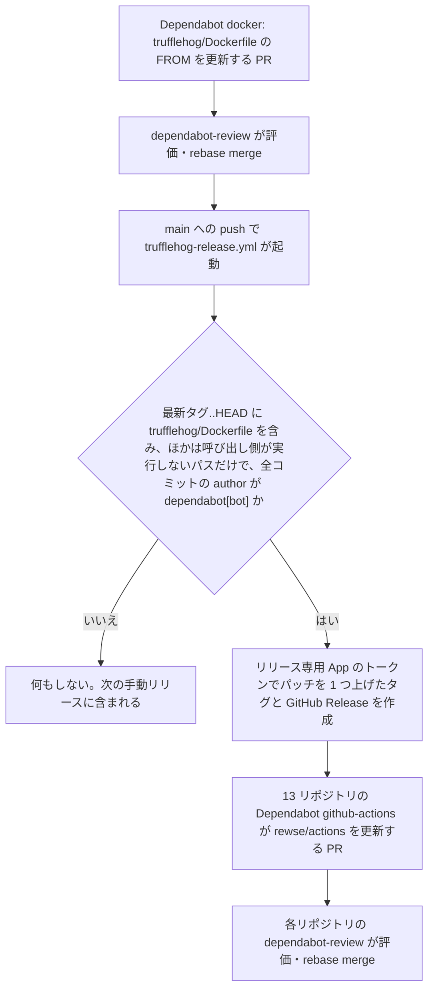

# TruffleHog の自前アクション化とイメージ更新の自動リリース

## 目的

`rewse/*` の各リポジトリで週次スイープを回す `trufflehog.yml` を、Dependabot の更新だけで最新の TruffleHog に追従させ、`dependabot-review` の自動マージに乗せる。

現状は `trufflesecurity/trufflehog` アクションを SHA で固定し、実際に動く CLI のイメージを `with: version: <tag>@sha256:<digest>` で別に固定している。上流アクションは composite で、`docker run "${IMAGE}:${VERSION}"` を実行するだけなので、Dependabot はアクションの SHA を上げても `version:` を更新しない。Kiro はこの不一致を正しく medium と評価するため、PR は毎回手動レビューに回る（例: rewse/dotfiles#14）。手で揃えきれず、リポジトリごとに 3.97.6 から 3.99.7 までばらついている。

## ゴール

- TruffleHog のイメージ更新が、`rewse/actions` 上で Dependabot の PR 1 本で完結し、タグとダイジェストが常に揃う。
- イメージ更新だけを含む変更は、`rewse/actions` のパッチリリースまで自動で進み、呼び出し側の 13 リポジトリには Dependabot の `github-actions` 更新として届く。
- 13 リポジトリの TruffleHog が同じバージョンに揃う。

## 非ゴール

- `actions.lock` への移行。zizmor と gh-actions-lock の対応リリースを待つため、別タスク（TickTick 登録済み、2026 年 11 月）とする。
- `dependabot-review` の評価ロジックの変更。
- TruffleHog の push / pull_request トリガーでの差分スキャン。今の運用は全履歴の週次スイープだけで、それ以外は gitleaks が担う。

## アンチゴール

- 呼び出し側が実行するコードの未リリースの変更が、自動リリースに巻き込まれて出ていくこと。`rewse/actions` には `dependabot-review` や `setup-safe-chain` も入っており、それらのリリースは引き続き手動で判断する。
- 自動リリースのために、タグ作成の権限が `dependabot-review` の GitHub App のような、ほかの目的で広い権限を持つ主体に開くこと。
- イメージをタグだけで参照し、ダイジェスト固定が外れること。

## 前提と制約

- 対象は `~/git` にクローンしている `rewse/*` の 13 リポジトリ（`actions`, `ansible-playbooks`, `cloudfront-waf`, `dotfiles`（クローン先は `~/git/chezmoi`）, `enecoq-data-fetcher`, `gnucash-import-agent`, `mac-power-monitor-mqtt`, `rewse-blog`, `security-agent`, `stock-price-fetcher`, `textlint-config-rewse`, `textlint-rule-ja-space-around-phrase`, `zenn-content`）。
- 呼び出し側は `rewse/actions/<name>@<sha>  # vX.Y.Z` で参照し、Dependabot の `github-actions` 更新で追従する。`rewse/*` は cooldown の対象外。
- `rewse/actions` のリリース（v1.1.1〜v1.1.5）は手動で作っており、`release.yml` もタグ用の ruleset もない。リポジトリは public。
- `rewse/actions` 自身にも Dependabot の `github-actions` と `pre-commit` の更新が毎週入る。自身のワークフローは `rewse/actions/dependabot-review@` と `setup-safe-chain@` を SHA で参照しているので、リリースのたびにそれを上げる PR も来る。v1.1.5 のあとには `81a6e14`（zizmor-pre-commit の更新）がすでに未リリースで残っている。
- `rewse/actions` では `dependabot-review` 自身も動いており、その GitHub App がこのリポジトリに `contents: write` を持つ。
- `dependabot-review` は GitHub App のトークンで rebase merge するため、マージの push で main の push トリガーのワークフローが起動する。rebase merge なのでコミットの author は `dependabot[bot]` のまま残る。
- 上流イメージ `ghcr.io/trufflesecurity/trufflehog` のエントリポイント `/etc/entrypoint.sh` は、最後の引数を空白区切りの追加引数として展開し、`safe.directory '*'` を設定してから `trufflehog` を実行する。
- 各リポジトリの `extra_args` の違いは `--exclude-detectors=lob` と `--exclude-paths=.trufflehog-exclude-paths.txt` の有無だけで、`--results=verified,unknown` は全リポジトリ共通。
- `.github` は `~/git/AGENTS.md` の GitHub Configuration に従う。

## アプローチ

イメージ更新を Dependabot に任せる方法として、3 案を比べた。

- **自前アクション + Dockerfile（採用）**: `rewse/actions/trufflehog/Dockerfile` の `FROM` でイメージを固定し、Dependabot の `docker` エコシステムにタグとダイジェストを同時に更新させる。上流アクションの分岐ロジックは手放すが、使っているのは全履歴スキャン 1 パターンだけなので、自前で持つ量は数行に収まる。
- Dependabot PR に `version:` を書き換えるコミットを積む: Dependabot 以外のコミットが入ると Dependabot がその PR を rebase しなくなり、`dependabot-review` の作成者チェックや `--match-head-commit` とも衝突するため却下した。
- 手動マージを続ける: 13 リポジトリ分の手作業が週次で残り、現にバージョンがばらついているため却下した。

自動リリースの仕組みとして、3 案を比べた。

- **main への push で起動するワークフロー（採用）**: 最新タグから HEAD までの差分がイメージ更新だけのときにパッチリリースを作る。マージ直後にリリースされる。
- 週次スケジュールで同じ条件を判定する: 動作は同じでリリースが最大 1 週間遅れる。push 起動で足りるため採らなかった。
- `dependabot-review` のマージ後にリリース手順を入れる: 11 リポジトリ共通のアクションに `rewse/actions` 固有の処理が入るため却下した。

## 設計

### 全体の流れ



### `rewse/actions/trufflehog`

- Docker コンテナアクション（`runs.using: docker`, `runs.image: Dockerfile`）とする。
- `Dockerfile` は `FROM ghcr.io/trufflesecurity/trufflehog:<tag>@sha256:<digest>` の 1 行だけにし、エントリポイントは上流のものをそのまま使う。初期値は着手時点の最新リリースとする。
- 入力は `extra-args` だけ（既定値は空文字列）。呼び出し側は `--results=verified,unknown` と、必要なら除外指定を渡す。
- `runs.args` は `git`, `file:///github/workspace`, `--branch`, `main`, `--fail`, `--no-update`, `--github-actions`, `${{ inputs.extra-args }}` の順に並べる。追加引数を最後に置くのはエントリポイントの仕様に合わせるため。`--since-commit` は付けず全履歴を走査する。
- 呼び出し側は今と同じく `actions/checkout` を `fetch-depth: 0` で先に実行しておく前提とし、README に書く。

### 呼び出し側の `trufflehog.yml`

`trufflesecurity/trufflehog` のステップを次の形に置き換える。`base`, `head`, `version` の入力と、`version:` を手で揃えるよう促すコメントは消す。cron やジョブ名などほかの部分は変えない。

```yaml
      - uses: rewse/actions/trufflehog@<sha>  # vX.Y.Z
        with:
          extra-args: --results=verified,unknown
```

`rewse/actions` 自身の `trufflehog.yml` は、未リリースの変更を自分で検証できるよう `uses: ./trufflehog` で参照する。

### `rewse/actions` の Dependabot 設定

`.github/dependabot.yml` に `docker` エコシステムを追加する。`directory: /trufflehog`、週次、`cooldown.default-days: 5`（zizmor の抑制コメント付き）、グループは 1 つにまとめ、ほかのエントリと同じ書式に揃える。呼び出し側の `dependabot.yml` は変えない。

### 自動リリース（`trufflehog-release.yml`）

- トリガーは `push`（`branches: [main]`, `paths: [trufflehog/Dockerfile]`）。`paths` は起動を絞るだけで、判定はジョブ内で行う。
- 最上位の `permissions` は `contents: read` とし、ジョブにも追加の権限は与えない。タグとリリースはリリース専用 App のトークンで作るため、`GITHUB_TOKEN` に書き込み権限は要らない。
- マージの push は `dependabot-review` の App が起こすので、このワークフローは Dependabot secrets ではなく Actions secrets を読める。リリース専用 App の秘密鍵は、デプロイ対象ブランチを `main` に限った Environment `release` の secret に置き、ジョブに `environment: release` を付ける。
- 判定は、セマンティックバージョンで最新の `v*` タグから `HEAD` までについて行う。
  - `git diff --name-only <tag>..HEAD` に `trufflehog/Dockerfile` が含まれること。
  - それ以外の変更ファイルが、呼び出し側が実行しないパス（`.github/`, `.pre-commit-config.yaml`, `tests/`, `docs/`）だけであること。`trufflehog/` のほかのファイル、`dependabot-review/`、`setup-safe-chain/`、ルート直下の上記以外のファイルが 1 つでもあれば止める。
  - `git log --format=%an <tag>..HEAD` が全件 `dependabot[bot]` であること。人が書いたコミットが混ざっていれば、パスにかかわらず止める。
  - どれかを満たさなければ、理由をジョブのサマリーに書いて正常終了する。
- 満たすときは、リリース専用の GitHub App のトークンを `actions/create-github-app-token` で発行し、最新タグのパッチを 1 つ上げたタグを `HEAD` に作り、`gh release create --generate-notes` で GitHub Release を作る。リリースノートの先頭には、Dockerfile の差分から読み取った TruffleHog の旧バージョンと新バージョンを書く。
- 同じ push で二重に動かないよう `concurrency` を設定する。

### リリース専用の GitHub App

タグを作る主体として、リリース専用の GitHub App を新しく作る。権限は `contents: write` だけで、インストール先は `rewse/actions` だけにする。`dependabot-review` の App は全リポジトリに `contents: write` を持つため、タグ作成に使わない。

### タグの保護

`rewse/actions` に ruleset `Protect release tags` を作る。`~/git/AGENTS.md` の既存ルールどおり、対象は `refs/tags/v*` で、作成・更新・削除を禁じる。バイパスできるのはリポジトリ管理者ロールとリリース専用 App だけにする。`GITHUB_TOKEN` と `dependabot-review` の App はタグを作れない。

呼び出し側は SHA で固定しているので、タグを動かされても実行されるコードは変わらない。ただ、作成を許すと任意のコミットに打ったタグへの更新を、cooldown 対象外の Dependabot PR として 12 リポジトリへ届けられてしまう。それを止めるのがこの ruleset の役目になる。

### `~/git/AGENTS.md` の更新

GitHub Configuration の該当ルールを次のように改める。

- `trufflehog.yml` は `rewse/actions/trufflehog` を使う、と書く。`trufflesecurity/trufflehog` の更新時に `version:` を手で揃える文は削る。除外指定（`--exclude-detectors`, `--exclude-paths`）のルールは、渡し先を `extra-args` にして残す。
- tag ruleset のルールに、`rewse/actions` は自動リリースのためリリース専用 App もバイパスに入れる、と足す。

`rewse/actions` の `AGENTS.md` と `README.md` にも、新しいアクションと自動リリースの条件を書く。

## 移行の順序

1. `rewse/actions` に `trufflehog/`、`dependabot.yml` の `docker` エントリ、`trufflehog-release.yml`、テスト、ドキュメントを入れ、自身の `trufflehog.yml` を `./trufflehog` に切り替えて、`workflow_dispatch` で一度スキャンが通ることを確かめる。
2. リリース専用 App を作って `rewse/actions` にインストールし、Environment `release` に秘密鍵を、Actions variables にクライアント ID を登録する。ruleset を作り、v1.1.6 を手動でリリースする。このリリースで `81a6e14` など既存の未リリースの変更も出ていく。
3. 12 リポジトリの `trufflehog.yml` を `rewse/actions/trufflehog@<v1.1.6 の SHA>` に切り替え、`workflow_dispatch` でスキャンが通ることを確かめる。開いたままの trufflehog 更新 PR（rewse/dotfiles#14 など）は閉じる。
4. `~/git/AGENTS.md` を更新する。

## ビルダーに任せること

- 判定とバージョン計算をシェルスクリプトに切り出すかどうか、切り出した場合のテストの書き方（既存の `tests/test_*.sh` の流儀に合わせる）。
- リリースノートの細かい文面とジョブサマリーの書式。
- 13 リポジトリへの展開を 1 リポジトリずつ PR にするか、直接 main に入れるか。各リポジトリの従来の運用に合わせる。
